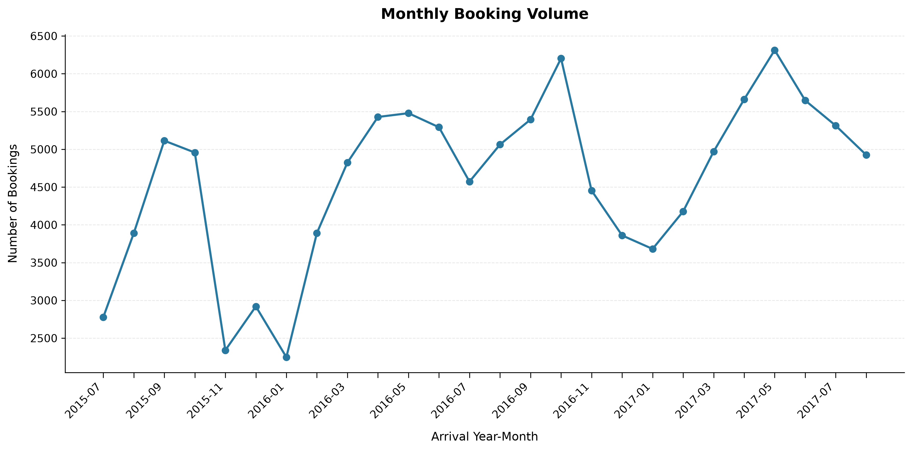
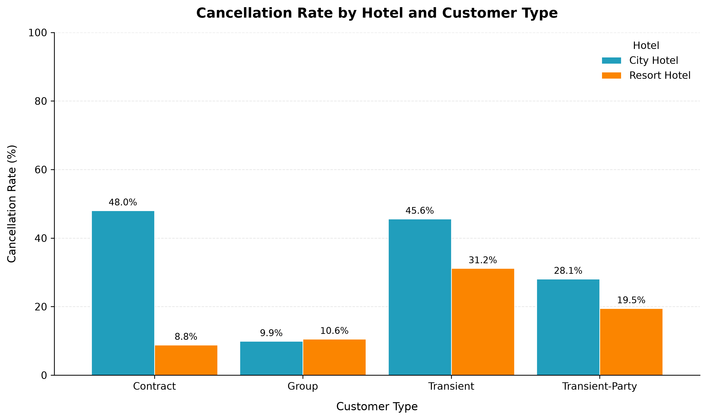
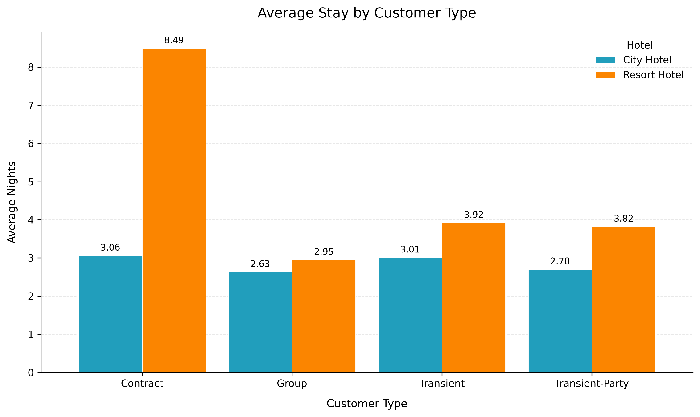
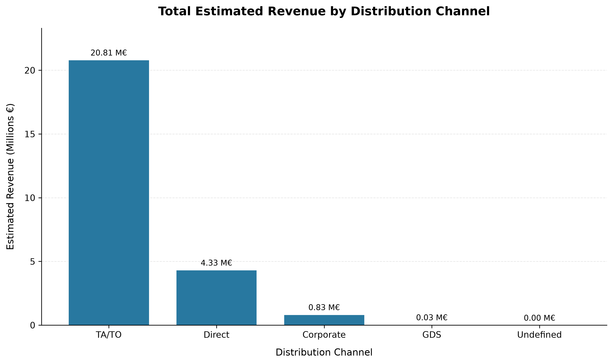

# Hotel Booking & Revenue Analysis

**A data analysis project exploring hotel booking patterns, cancellations, customer behavior, and estimated revenue using Python.**


## Project Overview

This project explores hotel booking data from two hotels in Portugal: City Hotel and Resort Hotel.

Using Python, Pandas, and Matplotlib, the analysis examines booking trends, seasonality, cancellation patterns, length of stay, customer segments, and estimated revenue across different distribution channels.

The main objective is to transform raw booking data into meaningful business insights that could support hotel management, demand analysis, and revenue-related decision-making.

The project follows a structured data analysis workflow, including data preparation, exploratory data analysis, data quality assessment, business-oriented analysis, and data visualization.

## Business Questions

1. How does the number of bookings evolve over time?

2. Is there a seasonal pattern in demand?

3. How does monthly estimated revenue evolve?

4. What is the average length of stay, and how does it vary?

5. How far in advance do customers make their bookings?

6. What is the booking volume and cancellation rate?

7. Which countries and booking channels generate the highest estimated revenue?

## Data Source

The main dataset used in this project is the **Hotel Booking Demand Dataset**, originally published in:

> Antonio, N., de Almeida, A., & Nunes, L. (2019).  

> _Hotel booking demand datasets._  

> _Data in Brief, 22_, 41–49.

The dataset contains booking information from two real hotels in Portugal:

- Resort Hotel

- City Hotel

The observations cover bookings with arrival dates between July 2015 and August 2017.

The dataset contains 119,390 booking records and includes both completed and canceled bookings.

Source:  

https://www.sciencedirect.com/science/article/pii/S2352340918315191

## Dataset Limitations

The dataset has several limitations that must be considered when interpreting the results:

- Customer identification data was removed for privacy reasons.

- The dataset represents two hotels rather than a single hotel.

- Customer-level longitudinal analysis is therefore limited.

- The dataset does not provide detailed operational costs.

- It does not include detailed spending on additional hotel services such as restaurants, spa treatments, excursions, or transportation.

- Customer satisfaction scores are not included.

Therefore, this project focuses primarily on booking behavior, demand, cancellations, revenue-related metrics, and customer segments rather than individual customer lifetime value.

## Analysis

### Data quality and duplicate records

The dataset contains 31,994 rows identified as duplicates by `pandas.DataFrame.duplicated()` using its default behavior.

These rows are identical to previously encountered rows across the available columns. However, the dataset does not provide a unique booking identifier to confirm whether they represent duplicate records or distinct bookings with identical attributes.

**Decision:** Duplicate rows will be retained in the processed dataset. They will not be removed automatically, as doing so could alter booking counts and other analytical results. This limitation will be considered when interpreting the findings.

### Missing values in children

Four records contain missing values in the `children` column. All four belong to canceled City Hotel bookings.

The available data does not establish the actual number of children in these bookings.

**Decision:** Missing values will be preserved as `NaN` rather than replaced with zero, because the absence of a recorded value does not prove that no children were included.

### Negative ADR value

One record contains a negative Average Daily Rate (ADR) of -6.38. The booking belongs to a Resort Hotel and is marked as not canceled. The available data does not establish why the ADR is negative.

Excluding this record has a negligible effect on the overall average ADR, changing it from approximately 101.8311 to 101.8320.

**Decision:** The original record will be retained in the dataset. However, the negative ADR will be excluded from analyses that assume non-negative room rates, where appropriate. The record will not be treated as a confirmed data error because its cause cannot be established from the available information.

### Bookings with no adults or guests recorded

The dataset contains 403 bookings with zero adults. Of these, 223 include children and/or babies, while 180 have no adults, children, or babies recorded.

Among the 180 bookings with no guests recorded, 70 have a total stay of zero nights and 110 have a positive total stay. The available data does not establish whether these records represent data-entry issues, unusual booking circumstances, or other situations.

**Decision:** These records will be retained in the dataset. They will not be automatically classified as invalid or removed, as the available information is insufficient to establish that they are erroneous. Their potential impact will be considered when analyzing guest counts, occupancy, and average stay duration.

### Bookings with zero nights

The dataset contains 715 bookings with a total stay duration of zero nights, calculated as the sum of weekend nights and weekday nights.

These records may represent different booking circumstances, but the available data does not establish why the total stay duration is zero.

**Decision:** These records will be retained in the dataset. They will not be automatically classified as invalid or removed. However, they will be considered when interpreting analyses involving length of stay and estimated revenue, as bookings with zero nights contribute zero to the estimated revenue calculation based on ADR multiplied by total nights.

### Cancellation rate by booking lead time

The cancellation rate varies across booking lead-time groups. Bookings made 30 days or less before arrival have a cancellation rate of 18.56%, compared with 57.01% for bookings made 181 days or more in advance.

This indicates an association between longer booking lead times and higher cancellation rates in the dataset.

**Business insight:** Bookings made far in advance may warrant closer monitoring, as they are associated with a higher likelihood of cancellation. Hotels could investigate whether reminder campaigns, flexible booking policies, or targeted follow-up strategies would be appropriate for these bookings.

**Limitation:** These results show an association, not causation. The analysis does not establish that booking lead time alone explains the differences in cancellation rates.

### Cancellation rate by customer type

Cancellation rates vary across customer types. Transient customers have the highest cancellation rate at 40.75%, followed by Contract customers at 30.96%, Transient-Party customers at 25.43%, and Group customers at 10.23%.

Transient customers account for 89,613 bookings, of which 36,514 were canceled. In comparison, the Group segment contains 577 bookings, with 59 cancellations.

**Business insight:** The Transient segment represents a key area for further investigation because it combines the largest booking volume with the highest cancellation rate. Understanding the characteristics and booking conditions of this segment could help hotels identify opportunities to manage cancellations.

**Limitation:** These differences show an association between customer type and cancellation rates. They do not establish that customer type itself causes cancellations. The Group segment also has a much smaller booking volume than the Transient segment.

### Cancellation rate by hotel and customer type

Cancellation rates vary across customer types and differ between City Hotel and Resort Hotel.

In City Hotel, the Contract segment has the highest cancellation rate at 48.04%, followed by Transient customers at 45.62%. Transient-Party customers have a cancellation rate of 28.10%, while Group customers have the lowest rate at 9.90%.

In Resort Hotel, Transient customers have the highest cancellation rate at 31.17%, followed by Transient-Party customers at 19.50%, Group customers at 10.56%, and Contract customers at 8.84%.

The largest difference between hotels occurs in the Contract segment, with cancellation rates of 48.04% in City Hotel and 8.84% in Resort Hotel, a difference of 39.20 percentage points.

**Business insight:** These results highlight customer segments that may warrant further investigation. In particular, the difference in Contract cancellation rates between the two hotels deserves closer examination. The Transient segment also accounts for the largest number of cancellations in both hotels because of its high booking volume.

**Limitation:** The observed differences do not establish the causes of cancellations. Further analysis of booking conditions and other relevant characteristics would be needed to investigate possible explanations.

### Cancellation contribution by hotel and customer type

Cancellation rate and cancellation contribution measure different aspects of booking cancellations. Cancellation rate measures the percentage of bookings canceled within a segment, while cancellation contribution measures the percentage of all canceled bookings represented by that segment.

City Hotel – Transient contributes the largest share of total cancellations, accounting for 61.27%. Resort Hotel – Transient is the second-largest contributor at 21.29%, followed by City Hotel – Transient-Party at 11.01%. Together, these three segments account for approximately 93.58% of all cancellations.

The segment with the highest cancellation rate is not the largest contributor to total cancellations. City Hotel – Contract has the highest cancellation rate at 48.04%, but contributes only 2.50% of all cancellations. City Hotel – Transient has a lower cancellation rate of 45.62%, but its much larger booking volume results in the highest cancellation contribution.

**Business insight:** If the objective is to reduce the overall number of cancellations, City Hotel – Transient may be a priority for further investigation because it represents the largest share of cancellations. Segments with higher cancellation rates should also be monitored, even when their contribution to the total is smaller.

**Limitation:** These metrics identify where cancellations are concentrated, but they do not explain why bookings are canceled. The results show patterns in this dataset and do not establish causal relationships.

### Booking patterns by country

The ten countries with the highest booking counts account for 84.78% of all bookings with a recorded country.

Portugal has the highest number of bookings among the countries analyzed, followed by the United Kingdom and France. Spain has the highest average Daily Rate (ADR) among the top ten countries, while Ireland has the highest estimated revenue per booking, at approximately €489.51.

Portugal has the lowest average ADR and the shortest average length of stay among these ten countries, at approximately 2.92 nights.

**Business insight:** The results highlight differences in booking volume, average room rates, and length of stay across markets. These metrics could help hotels identify which source markets to investigate further when developing pricing, marketing, and guest-retention strategies.

**Limitations:** The country analysis includes only the ten countries with the highest booking counts. Country-level averages do not explain the reasons behind the observed differences. Estimated revenue is calculated as ADR multiplied by total nights and should not be interpreted as actual revenue or profit. In addition, 488 bookings have no recorded country, so the country analysis does not cover every booking in the dataset.

### Overall findings

The analysis identified several patterns in hotel booking behavior, cancellations, length of stay, and estimated revenue.

**Booking cancellations**

Cancellation rates are higher among bookings made further in advance. Bookings made 181 days or more before arrival have a cancellation rate of 57.01%, compared with 18.56% for bookings made 30 days or less in advance.

Cancellation rates also vary across customer types and hotels. In City Hotel, the Contract segment has the highest cancellation rate (48.04%), while in Resort Hotel the highest rate corresponds to Transient customers (31.17%). These differences show associations, but do not establish the causes of cancellations.

**Length of stay**

Completed stays are longer on average at Resort Hotel (4.14 nights) than at City Hotel (2.92 nights).

The Contract segment at Resort Hotel stands out, with an average stay of 8.49 nights, compared with 3.06 nights at City Hotel. Transient customers account for the largest volume of completed stays in both hotels.

**Distribution channels**

TA/TO (Travel Agents and Tour Operators) accounts for 76.79% of completed bookings and 80.05% of their estimated revenue. Direct bookings represent 16.08% of completed bookings and 16.64% of estimated revenue.

The contribution of Direct bookings differs between hotels: they account for 22.82% of Resort Hotel's estimated revenue, compared with 11.65% at City Hotel. City Hotel shows a greater dependence on TA/TO channels.

These results describe booking volume and estimated revenue, but do not establish channel profitability because commission rates and acquisition costs are not available.

**Data quality**

The data quality assessment identified exact duplicate rows, missing values, a negative ADR value, bookings with no guests recorded, and bookings with zero nights. These records have been retained where the available information was insufficient to justify their removal. Their potential impact has been considered when interpreting the results.

**Important limitation**

Estimated revenue is calculated as ADR multiplied by total nights. It is a proxy derived from the available data and should not be interpreted as actual revenue or profit. The channel analysis of revenue and completed stays uses only bookings with a `Check-Out` reservation status.

## Key Visualizations

The following visualizations highlight some of the main findings of the analysis.

### 1. Monthly Booking Volume

Shows the evolution of booking volume over time, highlighting monthly fluctuations and seasonal patterns.



### 2. Cancellation Rate by Hotel and Customer Type

Compares cancellation rates across customer segments in City Hotel and Resort Hotel, revealing differences in cancellation behavior.



### 3. Average Stay by Customer Type

Compares the average length of completed stays across customer types and hotels.



### 4. Estimated Revenue by Distribution Channel

Compares estimated revenue from completed stays across distribution channels, highlighting the contribution of each channel.



_Note: Estimated revenue is calculated as ADR multiplied by total nights. It should not be interpreted as actual revenue or profit._

## All Visualizations

### Booking Analysis

- [Monthly Booking Volume](visuals/monthly_booking_volume.png)
- [Monthly Bookings by Hotel](visuals/monthly_bookings_by_hotel.png)
- [Year-over-Year Booking Growth](visuals/year_over_year_booking_growth.png)
- [Average Stay by Customer Type](visuals/average_stay_by_customer_type.png)

### Cancellation Analysis

- [Cancellation Rate by Lead Time](visuals/cancellation_rate_by_lead_time.png)
- [Cancellation Rate by Hotel](visuals/cancellation_rate_by_hotel.png)
- [Cancellation Rate by Hotel and Customer Type](visuals/cancellation_rate_by_hotel_customer_type.png)
- [Cancellation Pareto Analysis](visuals/cancellation_pareto_analysis.png)

### Revenue Analysis

- [Monthly Estimated Revenue](visuals/monthly_estimated_revenue.png)
- [Estimated Revenue by Distribution Channel](visuals/estimated_revenue_by_channel.png)
- [Estimated Revenue Share by Hotel and Distribution Channel](visuals/estimated_revenue_share_by_channel_hotel.png)

_Note: Estimated revenue is calculated as ADR multiplied by total nights. It is an estimate and should not be interpreted as actual revenue or profit._

## Repository Structure

```text
hotel-booking-revenue-analysis/
│
├── data/
│   └── raw/
│       └── hotel_bookings.csv
│
├── src/
│   ├── data_preparation.py
│   ├── 01_data_exploration.py
│   ├── 02_booking_analysis.py
│   ├── 03_cancellation_analysis.py
│   └── 04_revenue_analysis.py
│
├── visuals/
│   ├── monthly_booking_volume.png
│   ├── monthly_bookings_by_hotel.png
│   ├── year_over_year_booking_growth.png
│   ├── average_stay_by_customer_type.png
│   ├── cancellation_rate_by_lead_time.png
│   ├── cancellation_rate_by_hotel.png
│   ├── cancellation_rate_by_hotel_customer_type.png
│   ├── cancellation_pareto_analysis.png
│   ├── monthly_estimated_revenue.png
│   ├── estimated_revenue_by_channel.png
│   └── estimated_revenue_share_by_channel_hotel.png
│
├── README.md
└── requirements.txt
```

## Requirements

- Python 3.13
- pip (Python package installer).

### Python libraries

The project uses the following libraries:

- Pandas
- Matplotlib

### Installation

Clone the repository and install the required dependencies:

```bash
git clone https://github.com/Monikgbar/hotel-booking-revenue-analysis.git

cd hotel-booking-revenue-analysis

pip install -r requirements.txt
```

## Technologies

- Python 3.13

- Pandas

- Matplotlib

- VS Code

- Git

- GitHub

## Project Status

**Analysis completed**

The main data exploration and analysis phases have been completed.

The project currently includes:

- Data loading and preparation.
- Exploratory data analysis and data quality assessment.
- Booking and cancellation analysis.
- Length of stay analysis.
- Estimated revenue analysis.
- Distribution channel analysis.
- Business-oriented visualizations and documented findings.

Further improvements may include developing an interactive dashboard and expanding the business recommendations.
